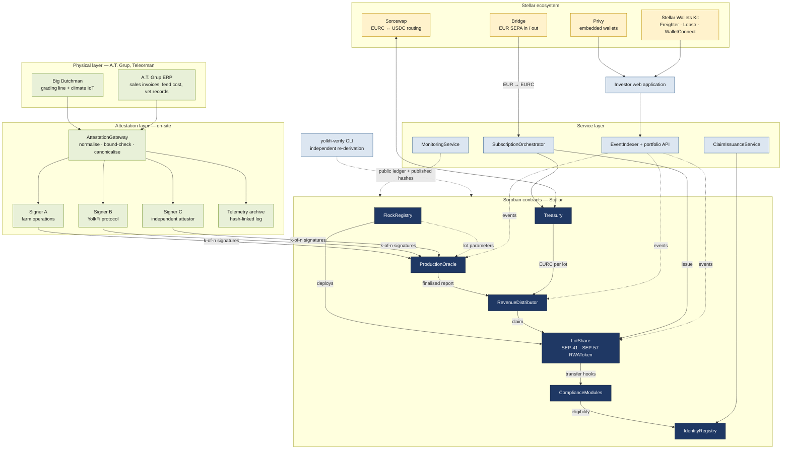
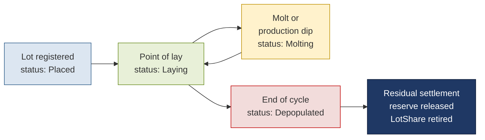
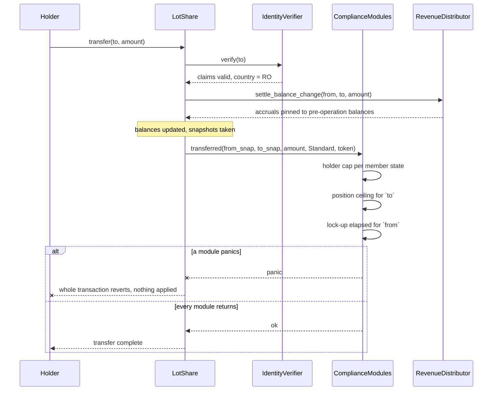
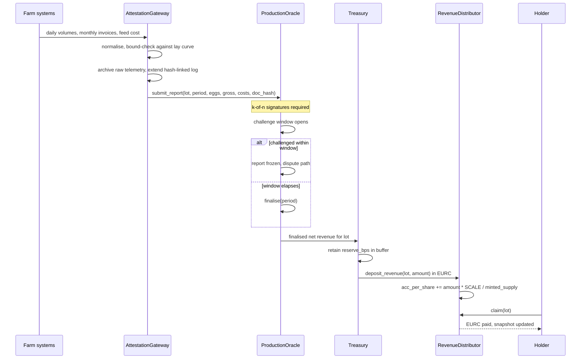
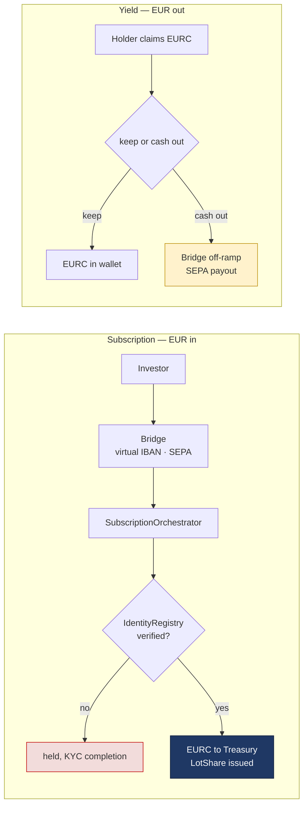
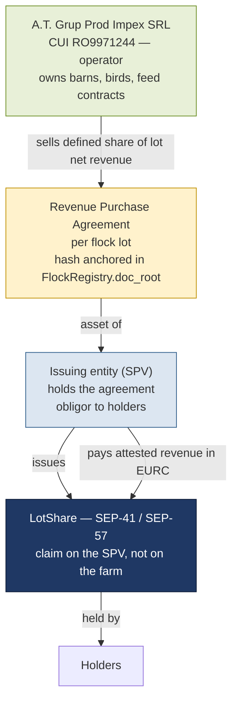

# YolkFi — Technical Architecture

**Verifiable revenue sharing on a live Romanian egg-production business, settled in EURC on Stellar.**

YolkFi turns individual production lots of an operating poultry farm into compliance-gated Stellar tokens whose
holders receive a share of that lot's attested net revenue. Every euro distributed is traceable back to a signed
production report from the farm's grading line, and any third party can re-derive every distribution from public
ledger data using a published command-line tool.

| | |
|---|---|
| **Underlying operator** | A.T. Grup Prod Impex SRL — CUI RO9971244, registered 26 November 1997, CAEN 0147 (poultry farming), Ferma Vlasca, Drăgănești-Vlașca, Teleorman County, Romania |
| **Operator scale (filed accounts, FY2025)** | RON 36,195,261 revenue (≈ €7.1M), RON 7,567,533 net profit, 62 employees |
| **Asset class** | Fixed-term revenue share on a named flock lot (commercial layers, Hendrix Genetics stock) |
| **Settlement asset** | EURC on Stellar (Circle-issued); USDC supported for routing |
| **Contract platform** | Soroban (Rust), SEP-41 token interface, SEP-57 regulated-asset framework |
| **Repository** | `github.com/YolkFi/yolkfi-protocol` (Apache-2.0), open before the first tranche begins; CI on every commit |

---

## 1. Why this is hard, and what the architecture has to solve

A revenue-sharing token on livestock is not a tokenisation wrapper around an idle asset. Four properties of the
underlying business dictate the entire design:

**Production is a decaying curve, not a constant.** A commercial layer is placed at 17–18 weeks of age, reaches
peak lay around week 26 at roughly 0.92–0.95 eggs per hen per day, then declines for the remainder of a cycle that
ends at 80–90 weeks. Averaged over a cycle a hen lays about 0.80–0.85 eggs per day, roughly 360–410 eggs in total.
A token that promises a flat yield is misrepresenting the asset. YolkFi therefore tokenises a **lot with a defined
term**, and distributes whatever that lot actually earns, period by period.

**Revenue is volatile and can be negative.** A.T. Grup's filed accounts show RON 36.2M revenue and RON 7.57M net
profit in FY2025, but also a RON 7.14M loss in 2019 and a net margin of 0.4% in 2024. Feed is the dominant input
cost and it moves with grain markets; avian influenza can close a barn. Any distribution mechanism that assumes
positive monthly net revenue will break in its first bad quarter. The protocol holds a per-lot reserve buffer and
can distribute zero for a period without entering an exceptional state.

**The data source is a commercial counterparty.** Production volumes and sale proceeds originate in the farm's own
Big Dutchman grading and ERP systems. A single service signing those numbers and pushing them on-chain is not
verifiable — it is the farm asserting its own revenue. The protocol uses a **k-of-n attestation set** with a
challenge window and plausibility bounds derived from the breed's published lay curve, and archives the raw
telemetry behind a hash-linked log so that any attested figure can be traced to the records it came from.

**The token is almost certainly a financial instrument.** Under MiFID II a token conferring a share of an
enterprise's revenue has the economic characteristics of a financial instrument, which excludes it from MiCA's
scope by virtue of MiCA Article 2(4). Compliance cannot be a KYC checkbox bolted onto a free-floating token:
transfer eligibility, holder counts and position limits must be enforced by the contract itself. YolkFi implements
the **SEP-57** regulated-asset framework so that the offering constraints the structure relies on are
mechanically impossible to breach.

---

## 2. System overview



---

## 3. The asset model: lots, not hens

A single hen is not a tokenisable unit — it is indistinguishable from its neighbours, it dies at a 3–5% annual
rate, and it stops laying on a schedule. The tokenisable unit is the **flock lot**: a batch of birds of one breed,
placed in one barn on one date, with one expected depopulation date.



Each lot carries, on-chain in `FlockRegistry`:

| Field | Purpose |
|---|---|
| `lot_id`, `barn_id` | Identity of the physical batch |
| `breed_code`, `placement_date`, `headcount` | Inputs to the plausibility bounds used by `ProductionOracle` |
| `expected_cycle_end` | Fixes the token's term — a `LotShare` is not perpetual |
| `share_supply` | Fixed at deployment; one share tracks one hen-equivalent of the lot |
| `reserve_bps` | Share of each period's net revenue retained in the lot's buffer |
| `doc_root` | Hash of the signed placement, veterinary and revenue-purchase documents |
| `status` | `Placed` → `Laying` ⇄ `Molting` → `Depopulated` |

`doc_root` is the anchor that makes the off-chain paperwork tamper-evident: the documents themselves stay private,
but their hash is public and immutable, so a holder can confirm that the agreement they were shown is the agreement
the contract was initialised with.

---

## 4. Contracts

| Contract | Responsibility | Key entry points |
|---|---|---|
| `FlockRegistry` | Lot lifecycle, document anchoring, deterministic deployment of per-lot `LotShare` instances, the on-chain allocation registry that gates primary issuance against `share_supply`, role administration, and the early-termination path | `register_lot`, `set_status`, `anchor_docs`, `deploy_lot_share`, `authorise_allocation`, `mint_allocated`, `early_terminate`, `lot_params` |
| `LotShare` | Per-lot fungible share implementing the SEP-41 interface and the SEP-57 `RWAToken` trait: forced transfer, partial freeze, recovery, mint, burn | `transfer`, `mint`, `burn`, `forced_transfer`, `freeze_partial`, `recover` |
| `IdentityRegistry` | The claim-based implementation of the SEP-57 `IdentityVerifier` interface that `LotShare` calls: `IdentityRegistryStorage` for investor profiles and country of residence, `IdentityClaims` for per-investor cryptographic claims, `ClaimTopicsAndIssuers` as the trust registry | `verify` (`IdentityVerifier`), `register_identity`, `add_claim`, `revoke_claim`, `set_claim_topics` |
| `ComplianceModules` | Pluggable modules behind the SEP-57 `Compliance` trait. The trait exposes exactly three **post-operation** hooks, and a module rejects by panicking, which reverts the whole transaction | `transferred(from, to, amount, kind, token)`, `created(to, amount, token)`, `destroyed(from, amount, token)` |
| `ProductionOracle` | k-of-n finalisation of production reports, challenge window, plausibility bounds, dispute path | `submit_report`, `attest`, `challenge`, `finalise`, `report_at` |
| `RevenueDistributor` | Per-lot cumulative revenue index, revenue deposit, pull-based claims, accrual settlement on every balance change (transfer, mint, burn, recovery, forced transfer), dust accounting | `deposit_revenue`, `claim`, `accrued`, `settle_balance_change`, `undistributed_dust` |
| `Treasury` | Per-lot EURC escrow, multisig disbursement authorisation, reserve buffer, exposure limits | `fund_lot`, `authorise_disbursement`, `release_reserve`, `lot_balance` |

### 4.1 Why `LotShare` is a SEP-41 token and not an NFT

An earlier design issued one non-fungible token per hen. That is unworkable at 200,000 birds and it misstates the
asset: holders own a *fraction of a lot's revenue*, which is by definition fungible within that lot. SEP-41
fungibility also makes the accrual accounting in §5 possible at constant cost, and lets the compliance layer reason
about positions as balances rather than enumerating token IDs.

The product surface keeps the farm vocabulary — the application shows "hens owned" and "eggs accrued" — but
"hens" are `LotShare` balances and "eggs" are accrued EURC, displayed in the unit the user understands. **There is
no separate egg token and no points system.** Accrued value is denominated in EURC from the moment it is attested.

### 4.2 Compliance is structural, not procedural

The offering structure this protocol supports depends on hard limits — a cap on holders per EU member state, a
qualified-investor gate for certain lots, a per-investor position ceiling, and a lock-up before secondary
transfer. These are enforced as `ComplianceModules`, so a transfer that would breach them cannot be executed, by
anyone, including YolkFi.

**How SEP-57 enforces this, precisely.** The `Compliance` trait is **not** a pre-flight check. It exposes three
post-operation hooks — `transferred`, `created`, `destroyed` — each receiving an `AccountSnapshot` of the
pre-operation balance and frozen state, plus a `TransferKind` (`Standard`, `Delegated` or `Forced`). A module
**rejects by panicking**, and Soroban's atomicity reverts the entire transaction. There is no `can_transfer` to
call and nothing to roll back by hand: the operation is applied, the hooks judge it, and a panic unwinds
everything. This is the architectural difference between SEP-57 and ERC-3643's validate-then-act sequence, and the
implementation follows it rather than reproducing the EVM pattern.



Settling accruals *inside* the operation is what prevents the classic revenue-share bug where a buyer acquires
shares and immediately claims revenue earned before they held them. The same settlement runs on **every** path
that changes a balance, not only `transfer`: a new holder's accumulator snapshot is initialised at `mint` (without
it, a fresh subscriber could claim a lot's entire history), accrual is settled at `burn`, and the snapshot is
migrated on `recover` and `forced_transfer` — the two SEP-57 primitives that move balances without the holder's
signature.

**On standards risk:** SEP-57 is a **Draft** (v0.4.0 at time of writing). The implementation pins the interface
version it was built against, keeps the compliance modules behind the trait boundary so a signature change is a
localised edit, and documents any delta from the published draft in `docs/sep57-conformance.md`. Building on a
draft is a real risk, and naming it is cheaper than being surprised by it.

---

## 5. Revenue accrual: pull, not push

The rejected design distributed revenue daily by iterating over holders. That approach costs one payment operation
per holder per period, grows linearly with the holder base, and cannot complete inside Soroban's per-transaction
resource limits once the holder count is non-trivial.

YolkFi uses a **cumulative index**. Each lot maintains `acc_per_share`, a scaled accumulator. When a period's
revenue is deposited, the accumulator is incremented **once**, regardless of how many holders exist:

```
increment      = (net_revenue - reserve) * SCALE / minted_supply
acc_per_share += increment
dust          += (net_revenue - reserve) - (increment * minted_supply) / SCALE
```

The denominator is **`minted_supply`, not `share_supply`.** `share_supply` is the lot's authorised ceiling, and a
lot is subscribed progressively; dividing by the ceiling would silently accrue the unsubscribed fraction to nobody
and make it permanently unclaimable. Dividing by issued supply, and re-deriving the index on each new issuance,
keeps every cent attributable.

Each holder stores a snapshot of the accumulator as of their last interaction. A claim pays the difference:

```
claimable = balance * (acc_per_share - snapshot[holder]) / SCALE
```

Both values are `i128` with **`SCALE = 10^12`**, and the bound is an explicit invariant rather than an
assumption:

```
cumulative_revenue_stroops * SCALE  <  i128::MAX
```

With EURC at 7 decimals, a lot earning €1M over its full cycle is `10^13` stroops; times `10^12` that is `10^25`,
thirteen orders of magnitude below the `i128` ceiling near `1.7 × 10^38`. Every multiplication and division uses
`checked_mul` / `checked_div`, and the release profile sets `overflow-checks = true` — a silent wrap in accrual
arithmetic is the one failure mode that would be invisible until someone's claim is wrong.

Three further properties the mechanism needs, each enforced:

- **`acc_per_share` is monotonically non-decreasing.** A decreasing index would make `acc − snapshot` negative for
  any holder who had already claimed. A loss-making period is therefore absorbed by the lot's reserve buffer, and
  any shortfall beyond the buffer is held as a `carry_forward` deficit netted against subsequent positive
  periods. The index is not touched, and no holder's accrued balance ever moves backwards.
- **Truncation is tracked, not discarded.** Integer division means a claim can never overpay, but the remainder
  has to go somewhere. Each deposit adds its truncated remainder to a per-lot `undistributed_dust` counter,
  released into the reserve at residual settlement. Without that counter the published reconciliation identity in
  §12 would not close.
- **Snapshots must stay reachable.** A dormant holder has, by definition, no write path, so their persistent
  snapshot entry would drift toward archival. A `TtlSweeper` in the monitoring service extends snapshot TTLs in
  bounded batches ahead of expiry, budgeted as contract rent. If an entry does archive anyway, it is restored
  automatically within the claim transaction itself (automatic restoration of archived persistent entries,
  Protocol 23 onward), at the cost of the restoration fee, which the platform's fee-bump covers. The sweeper is
  therefore a cost optimisation and a monitoring signal, not a correctness requirement.

| Property | Push (rejected) | Index accrual (adopted) |
|---|---|---|
| Cost of a revenue period | O(holders) | **O(1)** |
| Holder count ceiling | Bounded by transaction resource limits | Not bounded by the distribution mechanism — only by the compliance caps, which is a policy choice rather than a technical one |
| Dust and rounding | Accumulates silently per payment | Tracked in `undistributed_dust`, released into the reserve at residual settlement |
| Mid-period transfers | Mispays, or needs a snapshot pass | Settled in the transfer hook |
| Who pays the fee | Protocol, every period, for everyone | Holder, when they choose to claim — and fee-bumped by YolkFi so no XLM is needed |

Settlement runs on the farm's commercial rhythm — egg sales are invoiced monthly, so the attestation and
distribution cycle is monthly, with production telemetry still captured daily for verification and plausibility
checks. Claiming daily would be a UX fiction over a monthly cash cycle.



---

## 6. The attestation set: why the numbers can be trusted

`ProductionOracle` accepts a report only when it carries a valid signature quorum **that always includes the
independent attestor**. A plain 2-of-3 would be decorative here: the farm-operations signer and the protocol
signer sit on the same side of the table — one of them is a co-founder of the issuer who works at the operator —
so any threshold they can meet between themselves reproduces exactly the problem the attestation set exists to
solve. The attestor seat is therefore **mandatory**, implemented as signer weights in `FlockRegistry`
(operations 1, protocol 1, attestor 2, threshold 3): a report needs the attestor plus at least one of the other
two, and the two aligned signers alone cannot finalise anything.

| Signer | Basis of signature |
|---|---|
| **A — Farm operations** | Grading-line counts and barn telemetry from Big Dutchman systems |
| **B — YolkFi protocol** | Gateway-computed figures reconciled against the archived raw telemetry |
| **C — Independent attestor (mandatory)** | Settlement statements from the commercial egg buyer, cross-checked against invoiced revenue |

If no independent attestor is seated at launch, the configuration is stated as what it is — operator plus
protocol, with the attestor seat provisioned and empty — rather than presented as a three-party quorum it is not.

Four defences sit on top of the signature quorum:

1. **Volume bounds.** A report is rejected on submission if eggs-per-hen-per-day falls outside the envelope
   implied by the lot's breed code, flock age and headcount. The biologically impossible numbers that break naive
   RWA models — a 100% lay rate, for instance — cannot be finalised.
2. **Price and cost bounds.** Volume checks alone are not enough: an under-declared selling price or an inflated
   cost allocation would pass every volume test and quietly shrink the distributable amount. So the realised
   price per egg must fall inside a band around a published wholesale index, and the **cost-allocation formula is
   fixed on-chain per lot at registration** — not "declared in the lot's documents", where it would remain a
   variable the operator controls after subscription.
3. **Challenge window.** The window sits **before** finalisation, not after: a report moves
   `submitted → attested (quorum met) → challenge window → finalised → deposited`, and only a finalised report
   can move money. During the window any signer, or any holder presenting a conflicting figure, can challenge and
   freeze it, which routes it to the dispute path — challenged state, named resolution authority,
   re-attestation, and accounting continuity preserved across the gap.
4. **Hash-linked telemetry archive.** Every attested figure references the archive segment it was computed from.
   The archive is append-only and its head hash is published, so a later edit to historical telemetry is detectable.

This is the physical-to-digital bridge, and it is built and tested as a component of the protocol rather than
assumed to exist. For an asset whose value originates off-chain, it is the part that either earns a holder's trust
or does not.

---

## 7. Fiat and wallet layers



- **Bridge (Stripe)** handles EUR in and out over SEPA at roughly 0.10%, with EU coverage. For a euro-denominated
  product sold to EU investors this is materially cheaper than card rails. One practical constraint shapes the
  KYC design: Bridge's API returns verification *status*, not the underlying documents, so relying on Bridge's
  checks in the other direction is not workable. The flow therefore runs **YolkFi first** — identity is verified
  once by YolkFi's own provider, written as a claim in `IdentityRegistry`, and shared onward to the funding rail —
  rather than hoping to inherit a counterparty's KYC.
- **Privy** provides embedded Stellar wallets for investors with no crypto background: email or social login,
  enclave signing, and a scoped auto-signing policy for claim transactions.
- **Stellar Wallets Kit** covers self-custody users through Freighter, Lobstr and WalletConnect behind one
  connection interface. The existing YolkFi front end already integrates this kit, which is reused rather than
  rebuilt.
- **Soroswap** routes the USDC/EURC leg. This is not a hypothetical: stablecoin rails do not always settle in the
  denomination you asked for, and several Bridge corridors settle in USDC. When that happens the conversion sits
  **on the settlement path**, between proceeds arriving and funds entering a lot's escrow, so it gets quote and
  slippage controls and a price-impact guard rather than being treated as a convenience. When the rail settles
  EURC directly, the routing step is a no-op and the thesis in §8 holds end to end.
- **Investors never need to hold XLM, and that takes two mechanisms, not one.** Fee-bump transactions cover
  transaction *fees*, but an account's base reserve and the subentry reserve for an EURC trustline are a separate
  cost that fee-bumping does not touch. YolkFi therefore combines fee-bumped submission with **sponsored reserves**
  (`BeginSponsoringFutureReserves` / `EndSponsoringFutureReserves`): the platform sponsors account creation and the
  EURC trustline, and the reserve is returned to the sponsor if the trustline is later removed. `LotShare`
  balances need no trustline at all — they live in contract storage under the SEP-41 interface — but EURC is a
  classic asset, so a holder receiving a distribution to a `G…` account needs that trustline sponsored.

### 7.1 Secondary liquidity, stated honestly

A compliance-gated token cannot be listed on a permissionless AMM — an AMM pool would hold and distribute shares
to addresses that have never passed the `ComplianceModules` checks. YolkFi therefore provides a **permissioned
transfer path**: an off-chain intent and matching service, with settlement on-chain through `LotShare.transfer`,
which means every secondary trade passes the same eligibility checks as a primary subscription and settles the
seller's accrual at the moment of transfer. Soroswap is used for the stablecoin leg of the protocol's own
treasury operations, not for the share token. Saying otherwise would be an architectural claim the protocol cannot
honour.

---

## 8. Why Stellar

Stellar is not a deployment target of convenience here; three of its properties are load-bearing.

**Native EURC, callable from a contract.** The underlying business invoices in euro and pays its costs in euro. A
euro-denominated revenue share settled in a dollar stablecoin would inject an FX exposure that has nothing to do
with egg production. Stellar carries Circle-issued EURC natively, and — the part that matters architecturally —
its Stellar Asset Contract makes that classic asset callable directly from Soroban, so `RevenueDistributor` pays
euro-denominated claims from contract code without a wrapper token or a custodial step. That is what makes
euro-in, euro-accrued, euro-out possible with no synthetic FX layer. (YolkFi integrates existing EUR rails rather
than operating an anchor; see §14.)

**A regulated-asset standard to build against.** SEP-57 supplies the identity and compliance separation that a
revenue-share instrument needs, with a hook architecture that leverages Soroban's atomicity: a policy violation
panics and reverts the whole transaction rather than relying on a validate-then-act sequence. It is still a draft,
and §4.2 says what that costs — but building against a draft standard with a published interface is a different
proposition from writing and maintaining the entire framework alongside the product.

A third property, mundane and decisive: a monthly distribution per holder is a few euro, and on Stellar a claim
costs a fraction of a euro cent, fee-bumped and reserve-sponsored by the platform so the holder never touches XLM.
On a chain where a claim costs more than it pays, the accrual model in §5 degenerates into a custodial IOU — which
is exactly what tokenisation is supposed to remove.

What Stellar gets in return: a European agricultural RWA with monthly on-chain
settlement reconciled against filed company accounts, a reusable SEP-57 reference implementation for regulated
revenue-share instruments, and a published verification tool that any other RWA issuer on the network can adopt.

---

## 9. Business model and unit economics

Figures below are derived from A.T. Grup's filed accounts, not from projections. They are stated to show the
architecture is dimensioned for the real business; **no yield figure is promised to holders, and none should be
read into this document.**

| Quantity | Value | Basis |
|---|---|---|
| Flock in operation | ~200,000 commercial layers | Operator figure; to be corroborated against the site's authorised capacity in its environmental permit, which is a public record |
| Average lay rate over a cycle | 0.80–0.85 eggs/hen/day | Breed standard for Hendrix Genetics commercial layers |
| Implied monthly production | ~4.8–5.1M eggs | 200,000 × 0.80–0.85 × 30 |
| Implied annual production | ~58–61M eggs | 200,000 × 0.80–0.85 × 365 |
| FY2025 revenue (filed) | RON 36,195,261 ≈ €7.1M | Romanian company accounts, CUI RO9971244 |
| Implied realised price | **≈ €0.12 per egg** | €7.1M ÷ ~59M eggs per year, assuming egg sales account for substantially all revenue |
| FY2025 net profit (filed) | RON 7,567,533 | Same source |
| Historical downside | RON −7,143,119 (2019); 0.4% net margin (2024) | Same source — the reason `reserve_bps` exists |

A lot's distributable amount for a period is attested gross revenue, less a cost allocation computed by a formula
**fixed on-chain at lot registration**, less the reserve retained in `Treasury`. Both the cost-allocation formula
and the protocol fee are lot parameters written at registration and readable by anyone — neither is a variable the
operator can adjust after subscription, which is the whole point of putting them there rather than in a document.

Two numbers circulating in earlier YolkFi material do not survive contact with the filed accounts and have been
removed from this architecture: a production figure of 6M eggs per month, which for a 200,000-bird flock implies a
100% lay rate, and a €0.15 per-egg price, which would imply gross receipts about 1.5× the revenue actually filed
for FY2025. The protocol's volume and price bounds exist partly so that this class of error cannot be encoded
on-chain.

Every figure above is an **estimate used to size the system**, and each one is replaced by attested data from
period one: once a lot is live, its own `ProductionOracle` series is the authoritative record of what it produces
and what that produces in revenue, and the architecture never needs these estimates again.

### 9.1 How a share is valued

There is no appraisal step here, and no NAV oracle, because the asset is not an appraised object. A `LotShare` is
a claim on the **remaining attested revenue of a lot over a fixed remaining term**, so its value is determined by
three quantities that are all public on-chain:

| Input | Where it comes from |
|---|---|
| Revenue already distributed per share | `RevenueDistributor.acc_per_share` history |
| Remaining term | `FlockRegistry.expected_cycle_end` minus the current ledger time |
| Observed production trend for this specific lot | The finalised `ProductionOracle` report series |

A holder or a secondary buyer can compute an expected remaining return from the lot's own attested history rather
than from a figure YolkFi publishes. This is the protocol's substitute for a valuation oracle, and it is a
stronger one: the inputs are the same data the distributions are paid from, so a valuation and a payout cannot
diverge. It also means the protocol never needs to assert a price — which is why no yield figure appears anywhere
in this document.

---

## 10. Legal structure and asset linkage

The engineering design assumes, and depends on, the following structure. **None of it is engineering work** — it
is a legal prerequisite carried by the company, and it must be in place before any lot is offered. It is
documented here because the token cannot be assessed without it.



Holders hold a claim **against the issuing entity**, whose asset is a revenue purchase agreement with the operator
covering a named lot. They do not hold title to birds or barns. This is the standard SPV pattern for tokenised
real-world assets outside Switzerland, and the agreement's hash in `FlockRegistry.doc_root` is what makes the link
verifiable rather than merely asserted.

**Regulatory posture.** A revenue-share token is presumed to be a financial instrument under MiFID II, which
places it outside MiCA by virtue of Article 2(4) — so the relevant question is securities law, not CASP
registration. In Romania, GEO 10/2025 implements the MiCA framework with ASF as competent authority. The
compliance modules in §4.2 are built to enforce whichever offering perimeter counsel confirms: a qualified-investor
gate, a cap below 150 holders per member state, a per-lot offering ceiling, or any combination. **The structure
and its qualification must be confirmed by Romanian and EU counsel before any lot is offered**, and the protocol is
deliberately built so that the perimeter is a configuration of on-chain modules rather than a promise in a document.

---

## 11. Security: STRIDE threat model

| Category | Threat | Mitigation |
|---|---|---|
| **Spoofing** | A forged production report is submitted as if from the farm | k-of-n signature threshold on `ProductionOracle`; signer set held in `FlockRegistry` under admin role; `require_auth` on every privileged entry point |
| **Spoofing** | An ineligible wallet acquires shares through a third party | `ComplianceModules` evaluate `IdentityRegistry` claims on every transfer; no path to a balance bypasses the hooks |
| **Tampering** | Historical telemetry is edited to justify a past distribution | Append-only hash-linked archive with a published head hash; each attestation references its archive segment |
| **Tampering** | Inflated production figures are pushed on-chain | Plausibility bounds from breed lay curve, flock age and headcount; delta guards against the prior period; challenge window before funds move |
| **Repudiation** | The operator disputes a distribution after the fact | Every state change emits a Soroban event; `doc_root` anchors the agreement the lot was initialised with; `yolkfi-verify` re-derives distributions from public data |
| **Information disclosure** | Investor identity data is exposed on-chain | Only claim hashes and country codes are stored; documents and personal data stay with the KYC provider; `IdentityClaims` holds cryptographic claims, never source documents |
| **Denial of service** | A large holder base makes distribution impossible | O(1) accumulator update per period; pull-based claims; no unbounded iteration in any entry point |
| **Denial of service** | A dormant holder's accumulator snapshot archives and their claim fails | Snapshots are persistent entries with no natural write path, so a `TtlSweeper` extends them in bounded batches ahead of expiry, monitored against a rent-runway baseline; if an entry does archive, the claim transaction restores it automatically (Protocol 23 onward) and the fee-bump absorbs the restoration fee (§5) |
| **Elevation of privilege** | Admin keys mint shares or drain a lot's escrow | `Treasury` disbursement under multisig; **minting is gated on-chain** — `FlockRegistry.authorise_allocation` records an allocation and `mint_allocated` is the only mint path, bounded by `share_supply`, so the off-chain `SubscriptionOrchestrator` can request an issuance but cannot create one; role separation between admin, farm-operator and attestor; upgrades behind a timelock |

Each threat identifier carries into the on-chain monitoring plan, where it is paired with a monitor, a trigger
baseline and a documented response procedure, or an explicit recorded reason for having no monitor.

---

## 12. Verifiability: the property that distinguishes this build

Holders should not have to trust a dashboard. YolkFi ships **`yolkfi-verify`**, a command-line tool that
reconstructs the protocol's entire distribution history from public inputs only:

```
yolkfi-verify lot --id <lot_id> --from <period> --to <period>

  reads:   Stellar history archives (Hubble / Galexie public datasets) for periods
             older than public RPC retention, and Soroban RPC for recent ledgers
           published attestation hashes and archive head hashes
  checks:  Σ deposits = Σ claims + unclaimed accrual + reserve + undistributed_dust
           every deposit traces to a finalised report with k valid signatures
           every report falls inside the lot's plausibility envelope
           acc_per_share progression matches deposits and share_supply
  output:  per-period reconciliation, discrepancy report, exit code
```

**No YolkFi-operated service is required** — only public Stellar data. Two details make that true rather than
aspirational. First, public RPC retains history for a short window of days, so anything older is read from the
Stellar history archives; the indexer in §13 exists to serve the application quickly, not to be the source of
truth, and the CLI deliberately does not touch it. Second, `unclaimed accrual` is read from a per-lot on-chain
aggregate (`total_accrued − total_claimed`) rather than by summing every holder's snapshot, so the check stays
computable even when dormant snapshots have archived.

Part of the build is a clean-room run: a developer outside the core team reproduces a full verification using only
the public repository and public ledger data. A protocol whose arithmetic anyone can re-derive with the CLI is a
stronger claim than any assertion this document could make about its own correctness.

---

## 13. Technology choices

| Layer | Choice | Reasoning |
|---|---|---|
| Contracts | Rust, `soroban-sdk` | Native Soroban; property and fuzz testing through `proptest` and the SDK test harness |
| Token interface | SEP-41 + SEP-57 `RWAToken` | Ecosystem-standard interface; regulated-asset features (forced transfer, partial freeze, recovery) without bespoke extensions |
| Identity | SEP-57 `IdentityRegistryStorage`, `IdentityClaims`, `ClaimTopicsAndIssuers` | Separates identity from the token, so the same investor identity serves every lot |
| Compliance | SEP-57 `Compliance` hooks (`transferred`, `created`, `destroyed`) | Single hook per operation, relying on Soroban atomicity to revert on violation |
| Settlement asset | EURC on Stellar | Matches the operator's functional currency; removes FX from the yield |
| Gateway | Node.js with the Stellar JS SDK, on-site deployment | Runs beside the Big Dutchman systems; offline buffering and replay when connectivity drops |
| Signing | Split key custody, hardware secure element per signer | No single machine can produce a finalising quorum |
| Front end | React with server-side rendering | The current application is a client-only SPA, so link previews and crawlers see nothing but a tagline; SSR fixes a real and already-observed credibility problem |
| Indexer | Soroban RPC `getEvents` polling into Postgres (RPC retention is days, hence the history-archive path in §12) | Portfolio and accrual history served without trusting a private ledger |
| Data access | Soroban RPC primary, Horizon for classic payment history | RPC is the supported path for contract data |

---

## 14. Scope boundaries and future work

**Deliberately out of scope for this build:**

- **Multiple concurrent lots at scale.** The contracts are built for N lots, but this build registers and operates
  one real lot end to end. Proving one lot's full cycle machinery matters more than enumerating many.
- **A full end-of-cycle settlement.** A lay cycle runs 62–72 weeks, so a lot placed during this build will not be
  depopulated within it. `release_reserve` and the residual settlement path are implemented and tested, and
  exercised against a simulated cycle end; the first real depopulation settlement falls after the build window.
- **Becoming an anchor.** YolkFi integrates existing EUR rails rather than deploying Anchor Platform. Running an
  anchor is a month-plus of work that duplicates infrastructure the ecosystem already provides.
- **Card on-ramps.** SEPA covers EU investors at roughly a fortieth of card cost. Card funding is a later
  convenience, not a launch requirement.
- **Multiple independent attestors.** Launch runs one mandatory attestor seat. Raising the quorum as the holder
  base grows is the natural next step, but it adds coordination cost before it adds assurance.
- **Governance tokens, staking, or a secondary yield layer.** The asset is a revenue share on a farm. Adding
  financial layers on top would dilute exactly the property that makes it credible.
- **Legal, regulatory and entity work.** A prerequisite carried by the company, not engineering.

**Natural extensions once one lot is proven:**

- Additional lots and barns, including lots from other operators using the same registry and attestation pattern
- DeFindex or comparable yield routing for idle escrow balances between settlement periods
- Expanding the independent attestor set from one to several, raising the signature threshold as the holder base grows
- Publishing the attestation pattern as a reusable module for other agricultural RWA issuers on Stellar

---

## 15. Repository layout

```
yolkfi-protocol/
├── contracts/
│   ├── flock-registry/          # lot lifecycle, document anchoring, lot-share deployment
│   ├── lot-share/               # SEP-41 + SEP-57 RWAToken
│   ├── identity-registry/       # SEP-57 identity stack
│   ├── compliance-modules/      # jurisdiction, holder cap, position cap, lock-up
│   ├── production-oracle/       # k-of-n attestation, challenge window, bounds
│   ├── revenue-distributor/     # accrual index, pull claims
│   └── treasury/                # per-lot escrow, multisig disbursement, reserve
├── gateway/                     # on-site AttestationGateway, signer service, archive
├── services/
│   ├── subscription/            # Bridge webhooks, orchestration, issuance
│   ├── claims/                  # KYC adapter, claim issuance and revocation
│   ├── indexer/                 # event stream to read model
│   └── monitoring/              # watchers, invariant checks, alert routing
├── web/                         # investor application (SSR), operator console
├── verify/                      # yolkfi-verify CLI
└── docs/                        # this document, deployment guide, address registry
```

There are **seven contract crates**, but more than seven addresses on the network: each compliance module is its
own contract behind the `Compliance` trait, and `LotShare` is deployed once **per lot**. The authoritative count
is the address inventory in `docs/addresses.md`, which also carries every wasm hash and the reproducible build
procedure, so any deployed contract can be matched to the source that produced it.

---

*Delivery schedule and completion criteria: see [MILESTONES.md](./MILESTONES.md).*
